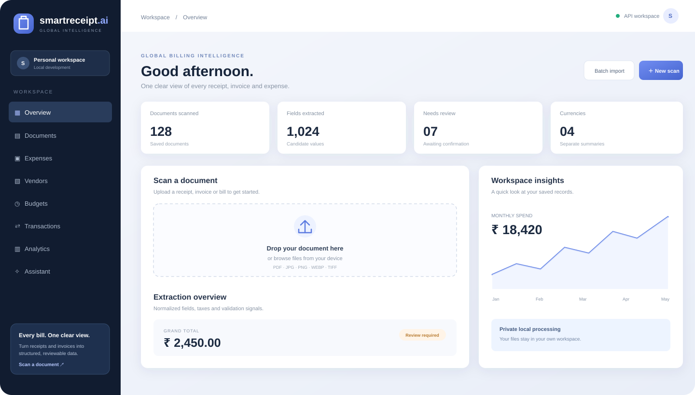
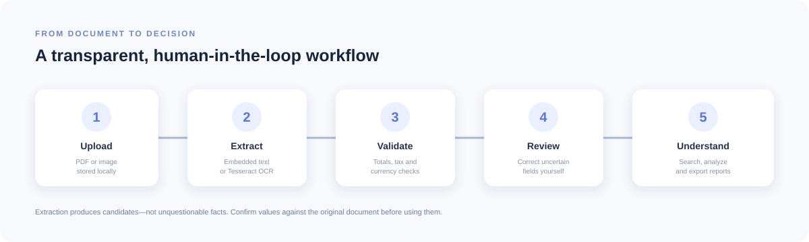
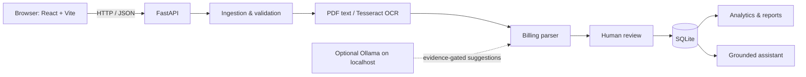

# SmartReceipt AI
### Turn receipts, invoices and bills into reviewable financial data.

<p align="center">
  
</p>

<p align="center">
  <strong>Local-first · Open-source stack · No paid API keys · Human-reviewed extraction</strong>
</p>

<p align="center">
  <a href="https://github.com/gigantic009/SmartReceipt-AI/actions/workflows/tests.yml"></a>
  
  
  
  
</p>

SmartReceipt AI is a portfolio-grade, local-first financial document intelligence application. Upload receipts, invoices, hotel folios and other billing documents; extract candidate fields; review uncertain values; and organize the results into a small expense workspace.

> **Preview note:** The image above is a designed product preview, not a live application screenshot. Replace it with a real screenshot after running the app if you want to show your own test data.

## Contents
- [What it does](#what-it-does)
- [Product preview](#product-preview)
- [Architecture](#architecture)
- [Technology](#technology)
- [Run locally](#run-locally)
- [Run with Docker](#run-with-docker)
- [Configuration](#configuration)
- [Tests and CI](#tests-and-ci)
- [API overview](#api-overview)
- [Privacy and security](#privacy-and-security)
- [Known limitations](#known-limitations)
- [Deployment readiness](#deployment-readiness)
- [Project structure](#project-structure)

## What it does

| Area | Included capability |
|---|---|
| Document intake | JPG, JPEG, PNG, WEBP, TIFF and PDF; multi-page PDFs; bounded batch upload |
| Text extraction | Embedded PDF text first; Tesseract OCR for scanned pages and images, with word-level confidence summaries for OCR pages |
| Billing interpretation | Candidate merchant, date, currency, totals, tax breakdown and document type |
| Validation | Reconciliation checks, ambiguity flags and review-required status |
| Document library | Search, pagination, saved records, corrections and deletion |
| Expense workspace | Manual expenses, vendors, budgets and category suggestions |
| Bank transactions | CSV import and explainable receipt-to-transaction matching with human confirmation |
| Reporting | CSV register, Excel workbook and PDF summary |
| Financial assistant | Bounded, deterministic questions grounded in saved local ledger data |
| Optional local AI | Ollama enrichment, off by default; evidence-gated suggestions only |

The parser supports common billing patterns and multiple currency/tax clues. OCR confidence is an average Tesseract word-recognition score for OCR-processed pages; embedded PDF text has no OCR confidence score. This is not a calibrated probability or a guarantee of field correctness. The parser is heuristic, not a certified tax engine.

## Product preview

<p align="center">
  
</p>

The intended workflow is simple: upload → extract → validate → review/correct → save → analyze/export. Always verify extracted values against the original document.

## Architecture



- **Frontend:** React 18, Vite and Lucide icons.
- **API:** FastAPI and Pydantic contracts.
- **Document processing:** PyMuPDF, Pillow, OpenCV and Tesseract OCR.
- **Storage:** SQLite with local filesystem document storage.
- **Exports:** openpyxl and ReportLab.
- **Optional enrichment:** Ollama running locally; disabled by default.

## Technology

| Layer | Technology |
|---|---|
| UI | React, Vite, CSS |
| Backend | Python, FastAPI, Uvicorn |
| OCR / files | Tesseract, pytesseract, Pillow, PyMuPDF, OpenCV |
| Database | SQLite |
| Reports | openpyxl, ReportLab |
| Quality | pytest, GitHub Actions |
| Local packaging | Docker, Docker Compose |

## Run locally

### Prerequisites
- Python 3.12 or newer (the CI workflow currently tests Python 3.12).
- Node.js 22 or newer and npm.
- Tesseract OCR installed and available on PATH.
- Git.

### 1. Clone the repository

```bash
git clone https://github.com/gigantic009/SmartReceipt-AI.git
cd SmartReceipt-AI
```

To work with the current development branch:

```bash
git switch feature/global-billing-platform
```

### 2. Set up the backend

**Windows CMD**
```cmd
py -3.12 -m venv .venv
.venv\Scripts\python.exe -m pip install --upgrade pip
.venv\Scripts\python.exe -m pip install -r requirements.txt
copy .env.example .env
```

If Tesseract is not on PATH, edit `.env` and set `TESSERACT_CMD` to the full path of `tesseract.exe`, for example:

```dotenv
TESSERACT_CMD=C:\\Program Files\\Tesseract-OCR\\tesseract.exe
TESSERACT_LANGUAGES=eng
SMARTRECEIPT_AI_PROVIDER=disabled
```

**macOS / Linux**
```bash
python3 -m venv .venv
source .venv/bin/activate
python -m pip install --upgrade pip
python -m pip install -r requirements.txt
cp .env.example .env
```

Install Tesseract using your operating system's package manager if it is not already installed.

### 3. Start the API

Windows CMD:
```cmd
.venv\Scripts\python.exe -m uvicorn backend.app.main:app --reload --host 127.0.0.1 --port 8000
```

macOS / Linux (with the virtual environment activated):
```bash
uvicorn backend.app.main:app --reload --host 127.0.0.1 --port 8000
```

API health: http://127.0.0.1:8000/health  
Interactive API docs: http://127.0.0.1:8000/docs

### 4. Start the frontend

Open a second terminal:

```bash
cd frontend
npm install
npm run dev
```

Open http://localhost:5173.

### 5. Run checks

From the repository root:

```bash
.venv\Scripts\python.exe -m pytest -q -p no:cacheprovider
```

Build the frontend:

```bash
cd frontend
npm install
npm run build
```

## Run with Docker

Requirements: Docker Engine/Desktop with the Compose plugin.

From the repository root:

```bash
docker compose up --build
```

- Web application: http://localhost:8080
- API: http://localhost:8000
- API docs: http://localhost:8000/docs

Stop containers:

```bash
docker compose down
```

The Compose configuration uses named volumes for the local database, uploaded files and OCR working files. To remove those volumes and all persisted local data:

```bash
docker compose down -v
```

**Warning:** `down -v` permanently deletes the app's persisted data. Export or back up anything you need first.

## Configuration

Copy `.env.example` to `.env`. Core functionality does not require API keys, payment details, a hosted AI provider or a cloud account.

| Variable | Default | Purpose |
|---|---|---|
| `TESSERACT_CMD` | `tesseract` | Tesseract executable path |
| `TESSERACT_LANGUAGES` | `eng` | Installed OCR language packs |
| `SMARTRECEIPT_AI_PROVIDER` | `disabled` | Optional enrichment switch |
| `OLLAMA_BASE_URL` | `http://127.0.0.1:11434` | Local Ollama endpoint |
| `OLLAMA_MODEL` | `llama3.1:8b` | Local model name |
| `SMARTRECEIPT_CORS_ORIGINS` | Local Vite and Compose origins | Allowed browser origins for the API |
| `VITE_API_URL` | `http://localhost:8000` | Browser-reachable API URL baked into the frontend Docker build |

### Optional local AI (not required)

The deterministic extraction path works without a language model. If you want to experiment with local enrichment, install Ollama and pull a model on your own computer, then configure the optional variables above and set `SMARTRECEIPT_AI_PROVIDER=ollama`. Model downloads use local disk and compute. The application is designed to restrict this integration to localhost and accept suggestions only when supported by OCR-visible evidence.

## Tests and CI

GitHub Actions runs:
1. Python compilation and backend pytest suite.
2. Frontend production build.
3. Backend and frontend Docker image builds.

The workflow is defined in [`.github/workflows/tests.yml`](.github/workflows/tests.yml). A green CI run verifies the automated checks in that run; it does not replace manual testing with varied real-world receipts and PDFs.

## API overview

| Method | Route | Purpose |
|---|---|---|
| GET | `/health` | Health check |
| POST | `/upload-document` | Upload image/PDF document |
| POST | `/upload-batch` | Upload a bounded batch |
| POST | `/upload-receipt` | Legacy single-image receipt flow |
| GET | `/receipts` | List/search saved documents |
| GET | `/receipts/{id}` | Read a saved document |
| PATCH | `/receipts/{id}` | Correct supported normalized fields |
| DELETE | `/receipts/{id}` | Delete a document |
| GET | `/receipts/{id}/events` | Read correction events |
| GET | `/analytics` | Currency-separated summaries |
| GET/POST | `/expenses` | List/create expenses |
| DELETE | `/expenses/{id}` | Delete an expense |
| GET/POST | `/vendors` | List/create vendors |
| GET/POST | `/budgets` | List/create budgets |
| GET | `/budgets/status` | Budget utilization |
| POST | `/transactions/import-csv` | Import bank CSV |
| GET | `/transactions` | List bank transactions |
| GET | `/transactions/{id}/match-candidates` | Suggest receipt matches |
| POST | `/transactions/{id}/match` | Confirm a match |
| POST | `/assistant/query` | Ask a grounded ledger question |
| GET | `/exports/receipts.csv` | Export document register |
| GET | `/exports/finance.xlsx` | Export finance workbook |
| GET | `/reports/summary.pdf` | Download PDF summary |

For request/response schemas, use the interactive OpenAPI docs at `/docs`.

## Privacy and security

- Processing and persistence are local by default; do not upload private documents to the public repository.
- Keep `.env`, database files, uploads, OCR artifacts, backups and real receipts out of Git.
- Spreadsheet exports mitigate formula injection for untrusted cell values.
- Upload validation applies size, format, image-dimension and PDF-page limits.
- The optional Ollama integration is local-only and disabled by default.

**Before exposing this app to the public internet**, add authentication, authorization and per-user data isolation; HTTPS and secure proxy configuration; CSRF/origin controls appropriate to the deployment; rate limiting; malware scanning; encrypted backups and storage; secret management; retention/deletion policies; audit logging; monitoring; and a production database/object store strategy. The current single-user SQLite prototype is not safe for multiple untrusted users.

## Known limitations

- OCR and field extraction are heuristic; low-quality scans, unusual layouts and handwritten text can fail. OCR confidence is a recognition signal, not a calibrated probability that parsed fields are correct.
- Country, currency, tax and document-type clues are not authoritative tax determinations.
- Line-item extraction is conservative candidate detection, not guaranteed table reconstruction.
- Category suggestions are rule-based, not a trained classifier.
- Exact duplicate detection uses file hashes; it does not detect visually similar documents.
- Analytics are limited to data saved in the local database and do not convert currencies.
- The financial assistant answers a bounded set of deterministic ledger questions; it is not a general-purpose chatbot.
- No authentication, multi-user isolation or production-grade cloud deployment controls are included yet.

## Deployment readiness

**Ready for:** local evaluation, classroom demonstration, portfolio review and single-user self-hosted experimentation on a trusted machine.

**Not yet ready for:** public multi-user SaaS, handling other people's financial records, or internet-facing production deployment without the security and operations work listed above.

See [DEPLOYMENT.md](DEPLOYMENT.md) for the deployment checklist and operational notes.

## Project structure

```text
backend/
  app/                 FastAPI routes, OCR, parsers, persistence and reports
  data/                Runtime SQLite data (generated locally)
  uploads/              Runtime uploads (generated locally)
frontend/
  src/                  React workspaces and styles
docs/
  assets/               README product-preview illustrations
tests/                  Backend automated tests
.github/workflows/      CI pipeline
Dockerfile
docker-compose.yml
DEPLOYMENT.md
```

## Contributing

Issues and pull requests are welcome. Please use synthetic/sample documents for tests, add regression coverage for parser changes, and never commit personal financial documents or local database files.

## License

See [LICENSE](LICENSE) if present in this repository. If no license file exists yet, the source is visible on GitHub but is not automatically granted an open-source reuse license.
